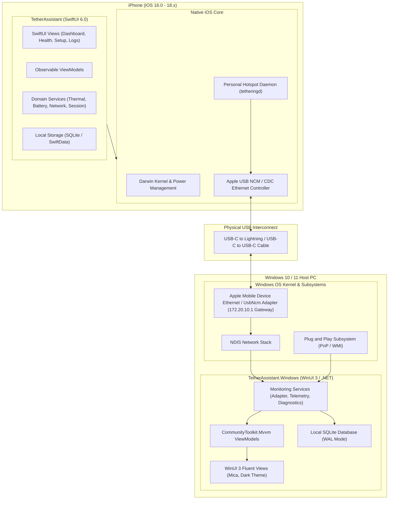
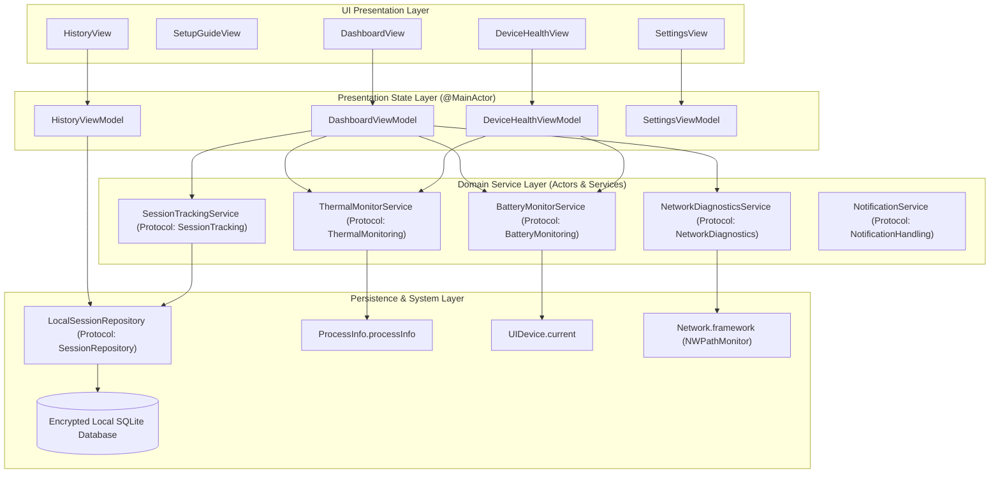
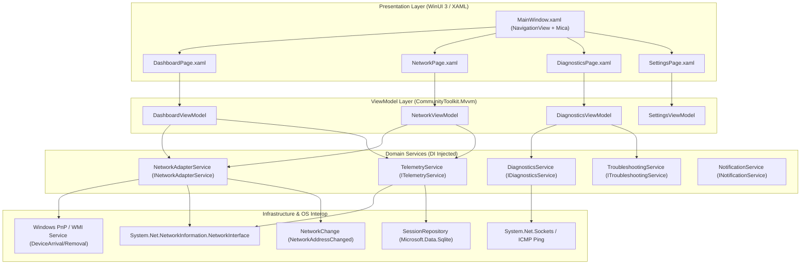
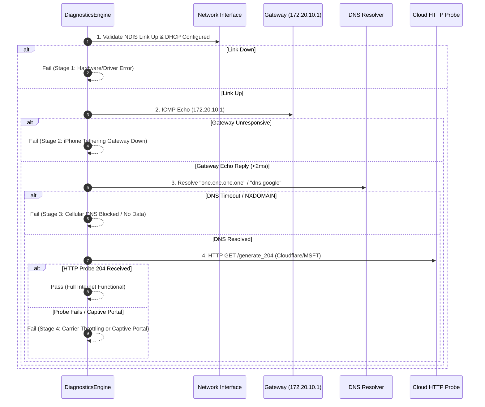

# System Architecture & Design Specification

## 1. High-Level Architectural Topology

The USB Tethering Assistant ecosystem is designed around an **independent, zero-cloud, decoupled architecture**. Both the iOS application and the Windows companion operate autonomously while complementing each other when tethered via a standard USB cable.



### Architectural Principles
1. **Decoupled Operation**: Neither client requires a proprietary IPC daemon, peer-to-peer TCP socket, or cloud relay between the phone and PC. The communication channel is strictly the standard NDIS network interface created by native Apple USB tethering.
2. **Platform Native Concurrency**:
   - iOS leverages **Swift 6 Structured Concurrency** (`async`/`await`, actors, `AsyncStream`) with `@MainActor` binding for SwiftUI rendering.
   - Windows leverages modern **C# Task Asynchronous Pattern (TAP)**, thread pool offloading, and WinUI 3 `DispatcherQueue` dispatching.
3. **Zero Polling Where Possible**:
   - iOS: Uses OS-level event notifications (`ProcessInfo.thermalStateDidChangeNotification`, `UIDevice.batteryLevelDidChangeNotification`, `NWPathMonitor` update handlers).
   - Windows: Uses `NetworkChange.NetworkAddressChanged`, `NetworkChange.NetworkAvailabilityChanged`, and WMI event listeners (`__InstanceOperationEvent`) for hardware insertions/removals. Polling is restricted strictly to active throughput counters (1-second intervals during active data transfer).
4. **Privacy-First Local Persistence**: All connection logs, throughput metrics, and thermal history stay on the local device inside SQLite / SwiftData databases. No telemetry is transmitted over the internet.

---

## 2. iOS Application Architecture (`TetherAssistant`)

The iOS application follows the **Clean MVVM (Model-View-ViewModel)** pattern with strict protocol-oriented dependency injection.



### Component Breakdown

#### Presentation Layer (SwiftUI Views)
- **Declarative Navigation**: Implemented via `NavigationStack` with typed destination enums.
- **Dynamic Theming**: Custom dark color palette optimized for OLED displays (pure blacks `#000000`, deep zinc `#121214`, and vibrant semantic accents: emerald `#10B981`, amber `#F59E0B`, crimson `#EF4444`).
- **Responsive Gauges**: Custom SwiftUI canvas and shape animations for battery discharge vectors and thermal gradients.

#### ViewModel Layer
- Each view model is annotated with `@MainActor` and conforms to `ObservableObject` (or uses the Swift 5.9+ `@Observable` macro).
- ViewModels receive protocols via initializer injection, allowing for 100% mocked unit tests without hardware dependencies.
- Exposes immutable state structures and reactive publishers (`AsyncStream` or `@Published`).

#### Domain Service Layer
- **`ThermalMonitorService`**:
  - Subscribes to `ProcessInfo.thermalStateDidChangeNotification`.
  - Normalizes raw `ProcessInfo.ThermalState` (`.nominal`, `.fair`, `.serious`, `.critical`) into domain events.
  - Generates adaptive cooldown recommendations based on state velocity (rapid jump from nominal to serious).
- **`BatteryMonitorService`**:
  - Activates `UIDevice.current.isBatteryMonitoringEnabled = true`.
  - Monitors `batteryLevel` (0.0 to 1.0) and `batteryState` (`.unplugged`, `.charging`, `.full`).
  - Detects high thermal charging risk (e.g. charging when thermal state is `>= .serious`).
- **`NetworkDiagnosticsService`**:
  - Uses `Network.framework`'s `NWPathMonitor` to observe path interface status.
  - Identifies cellular technology indicators (`CTTelephonyNetworkInfo` for 5G NR, LTE, etc.).
  - Evaluates constrained/expensive data flags.
- **`SessionTrackingService`**:
  - Encapsulates active tethering sessions, computes elapsed connection time, thermal peaks, and persists to repository.

---

## 3. Windows Companion Architecture (`TetherAssistant.Windows`)

The Windows application is built on **.NET 8 / 9 / 10** utilizing **WinUI 3** and the **Windows App SDK** (WASDK), structured with the **CommunityToolkit.Mvvm** framework.



### Component Breakdown

#### Adapter Detection Engine (`NetworkAdapterService`)
Unlike legacy utilities that check if the adapter string contains `"Apple Mobile Device Ethernet"` (which fails on non-English Windows or when Windows 11 binds generic UsbNcm drivers), this engine applies a **multi-factor heuristic**:
1. **PnP Device ID Check**: Inspects WMI `Win32_PnPEntity` for Apple's USB Vendor ID (`VID_05AC`).
2. **Subnet & Gateway Signature**: Evaluates whether the IPv4 gateway equals `172.20.10.1` and subnet mask is `255.255.255.240` (`/28`).
3. **NDIS Hardware Interface Type**: Asserts the interface physical medium is `NetworkInterfaceType.Ethernet` and not loopback or tunnel.

#### Live Telemetry Engine (`TelemetryService`)
- Subscribes to adapter state changes.
- Samples `IPv4InterfaceStatistics.BytesReceived` and `BytesSent` at 1000ms intervals using a low-overhead background `System.Threading.PeriodicTimer`.
- Derives instant throughput (Mbps), cumulative session payload, and packet loss rate.
- Posts metrics to the UI thread via `DispatcherQueue` without UI stutter.

#### Diagnostics Engine (`DiagnosticsService`)
Executes an isolated 4-stage pipeline returning detailed latency and error codes:


---

## 4. Cross-Platform Data Contracts & Schemas

Even though the apps do not establish a continuous network socket between them (to avoid complex pairing, firewall restrictions, and security risks), they share standardized domain schemas for diagnostic data, session history, and metrics.

### Diagnostic Result Model (`shared/schemas/diagnostic_result.json`)
```json
{
  "$schema": "https://json-schema.org/draft/2020-12/schema",
  "title": "DiagnosticResult",
  "type": "object",
  "properties": {
    "timestampUtc": { "type": "string", "format": "date-time" },
    "overallStatus": { "type": "string", "enum": ["Healthy", "Degraded", "Failed"] },
    "stages": {
      "type": "array",
      "items": {
        "type": "object",
        "properties": {
          "stageName": { "type": "string" },
          "isPassed": { "type": "boolean" },
          "latencyMs": { "type": "number" },
          "errorMessage": { "type": ["string", "null"] }
        },
        "required": ["stageName", "isPassed", "latencyMs"]
      }
    },
    "recommendation": { "type": "string" }
  },
  "required": ["timestampUtc", "overallStatus", "stages"]
}
```

---

## 5. Persistence Architecture

### Windows Persistence (`SQLite`)
- Engine: `Microsoft.Data.Sqlite`
- Journal Mode: `PRAGMA journal_mode = WAL;` (Write-Ahead Logging for high read/write concurrency).
- Synchronous Mode: `PRAGMA synchronous = NORMAL;` (optimal balance between performance and durability).
- Schema:
  - `sessions`: `id (UUID)`, `startTime (INTEGER)`, `endTime (INTEGER)`, `bytesReceived (INTEGER)`, `bytesSent (INTEGER)`, `peakThroughputMbps (REAL)`, `adapterName (TEXT)`.
  - `diagnostic_logs`: `id (UUID)`, `sessionId (UUID)`, `timestamp (INTEGER)`, `stage (TEXT)`, `passed (INTEGER)`, `latencyMs (REAL)`, `details (TEXT)`.

### iOS Persistence (`SwiftData / SQLite`)
- Stores thermal events and battery discharge snapshots.
- Schema:
  - `TetherSession`: `id (UUID)`, `startedAt (Date)`, `endedAt (Date?)`, `initialBatteryPercent (Float)`, `finalBatteryPercent (Float?)`, `peakThermalState (Int)`, `wasCharging (Bool)`.
  - `ThermalEvent`: `timestamp (Date)`, `state (Int)`, `deviceModel (String)`, `batteryLevel (Float)`.

---

## 6. Resource Efficiency & Performance Targets

| Metric | iOS App Target | Windows App Target |
| :--- | :--- | :--- |
| **Idle CPU Usage** | < 0.1% | < 0.2% |
| **Active Telemetry CPU** | < 1.0% (Screen On) | < 1.5% (1s polling) |
| **RAM Footprint** | < 35 MB | < 65 MB |
| **App Launch Time (Cold)** | < 450 ms | < 800 ms |
| **Diagnostic Execution Time**| < 2.5 seconds | < 2.0 seconds |
| **Disk Write Rate** | Batched every 60s (<10 KB) | Batched every 30s (<15 KB) |
