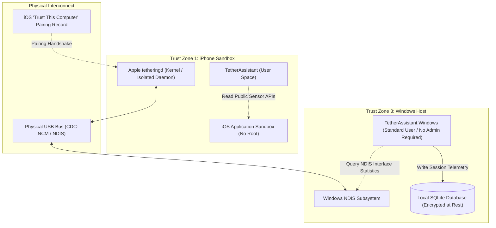

# Security, Privacy & Trust Model

## 1. Executive Security Architecture

The USB Tethering Assistant ecosystem operates under a **Strict Zero-Trust, Zero-Telemetry, Unprivileged Execution** philosophy. Neither the iOS application nor the Windows companion acts as a network proxy, man-in-the-middle (MitM) TLS decryptor, or packet inspection engine.

---

## 2. Threat Modeling (STRIDE Analysis)

| Threat Category | Potential Attack Vector | Applied Mitigation Strategy |
| :--- | :--- | :--- |
| **Spoofing** | Rogue USB device pretending to be an iPhone tethering adapter. | Windows Companion verifies the PnP Hardware ID (`VID_05AC`) and validates the strict subnet mask `/28` (`255.255.255.240`) and gateway `172.20.10.1`. |
| **Tampering** | Modification of local session logs or database records. | Local SQLite database is protected by Windows DPAPI (Data Protection API) / ACLs restricted strictly to the current user's profile. |
| **Repudiation** | Dispute of recorded data consumption metrics. | Logs are stamped with UTC timestamps and signed interface identifiers. Stored strictly locally. |
| **Information Disclosure** | Snooping on user internet browsing, visited URLs, or DNS traffic. | **Zero Packet Inspection**: The application never captures raw network packets, inspects TCP payloads, or logs DNS requests. Only aggregate byte counters (`BytesReceived`, `BytesSent`) are queried from NDIS. |
| **Denial of Service** | High-frequency telemetry polling saturating system CPU or memory. | Non-blocking `System.Threading.PeriodicTimer` with 1-second sampling intervals; event-driven state transitions; total CPU utilization capped at `< 0.2%` idle, `< 1.5%` active. |
| **Elevation of Privilege** | Requiring local Administrator rights or installing custom kernel drivers. | **Unprivileged Execution**: The Windows companion runs entirely as a standard Windows user. No kernel drivers, filter drivers, or elevated services are installed. |

---

## 3. Privacy & Data Governance

### Zero Cloud Telemetry Policy
- **No Third-Party Analytics**: No Google Firebase, Mixpanel, Sentry, or Segment SDKs are embedded in either application.
- **No Remote Telemetry Transmission**: Metrics such as session start/end time, data transferred, thermal states, and latency figures are written exclusively to local device storage.
- **User-Controlled Data Erasure**: Both iOS and Windows applications provide a single-click "Clear History" button in Settings that executes a cryptographic erasure (`PRAGMA secure_delete = ON; DELETE FROM sessions; VACUUM;`).

### Diagnostics Probe Privacy
The automated 4-tier diagnostics pipeline performs minimal, privacy-preserving checks:
1. **Gateway Echo**: Local ICMP ping to `172.20.10.1` (never leaves the local USB bus).
2. **DNS Resolution**: Queries standard public root records (`one.one.one.one` / `dns.google`) through the local iOS forwarder. No browsing domains are inspected.
3. **WAN HTTP Probe**: Performs an unauthenticated HTTP `GET` request to standard captive portal detection endpoints (`http://cp.cloudflare.com/generate_204`). No user identifiers, cookies, or payloads are transmitted.

---

## 4. USB Security & Pairing Handshake

### Apple "Trust This Computer" Protocol
Under iOS, physical USB data connections are gated by Apple's cryptographic lockdown daemon (`lockdownd`):
- When an iPhone is connected to an untrusted Windows PC, data pins are disabled at the software level. Only 5V power negotiation takes place.
- To enable Personal Hotspot over USB, the user **must physically unlock the iPhone with their passcode** and tap **"Trust"**.
- A unique 2048-bit RSA/ECC pairing certificate is exchanged and stored in:
  - Windows: `%ProgramData%\Apple\Lockdown\pair_records\`
  - iPhone: `/var/root/Library/Lockdown/pair_records/`
- The Tether Assistant applications **do not access, modify, or forge pairing certificates**, adhering strictly to native operating system trust guarantees.
