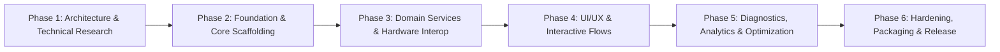

# Development Plan & Engineering Roadmap

## 1. Project Overview & Milestones

The USB Tethering Assistant project is divided into six structured execution phases spanning architecture, core platform development, UI/UX, diagnostics, performance optimization, and distribution.

### Key Milestones
- **M1 (Architecture Freeze)**: System specifications, API contracts, and sandbox boundary documentation approved.
- **M2 (Core Engine MVP)**: Windows adapter detection working via PnP/NDIS; iOS thermal & battery monitoring operational.
- **M3 (Telemetry & UI MVP)**: Real-time throughput graphs on Windows; complete 5-tab SwiftUI interface on iOS.
- **M4 (Full Diagnostics)**: 4-tier network diagnostic pipeline on Windows; smart thermal alert engine on iOS.
- **M5 (Production Release)**: Signed iOS IPA instructions validated on SideStore/AltStore; Windows MSIX/InnoSetup installer generated.

---

## 2. Detailed Work Breakdown Structure (WBS)

### Phase 1: Architecture & Technical Research
- [x] **Task 1.1**: Conduct deep research into Apple CDC-NCM and Apple Mobile Device Ethernet protocols.
- [x] **Task 1.2**: Document iOS sandbox boundaries (`ProcessInfo`, `NWPathMonitor`, battery APIs, background limitations).
- [x] **Task 1.3**: Research Windows NDIS, WMI PnP device enumeration (`VID_05AC`), and routing table heuristics.
- [x] **Task 1.4**: Define cross-platform architecture, MVVM topologies, and local persistence schemas.
- [x] **Task 1.5**: Author complete API specifications and architectural documentation.

### Phase 2: Foundation & Core Scaffolding
- [x] **Task 2.1**: Initialize iOS project layout (`TetherAssistant.xcodeproj`, Swift 6, SwiftUI, iOS 16+ target).
- [x] **Task 2.2**: Configure iOS Dependency Injection container, application entry point, and logging framework (`OSLog`).
- [x] **Task 2.3**: Initialize Windows project layout (`TetherAssistant.Windows`, WinUI 3, Windows App SDK, .NET 8/9/10).
- [x] **Task 2.4**: Configure Windows IoC container (`Microsoft.Extensions.DependencyInjection`), base MVVM classes (`CommunityToolkit.Mvvm`).
- [x] **Task 2.5**: Set up local SQLite persistence layers on both platforms with WAL mode.

### Phase 3: Domain Services & Hardware Interop
- [x] **Task 3.1 (iOS)**: Implement `ThermalMonitorService` listening to `thermalStateDidChangeNotification`.
- [x] **Task 3.2 (iOS)**: Implement `BatteryMonitorService` tracking battery level and charging states.
- [x] **Task 3.3 (iOS)**: Implement `NetworkDiagnosticsService` wrapping `NWPathMonitor`.
- [x] **Task 3.4 (iOS)**: Implement `SessionTrackingService` and local database persistence.
- [x] **Task 3.5 (Windows)**: Implement `NetworkAdapterService` detecting Apple USB Ethernet via PnP VID and `172.20.10.1` subnet.
- [x] **Task 3.6 (Windows)**: Implement `TelemetryService` sampling NDIS byte counters (`IPv4InterfaceStatistics`).
- [x] **Task 3.7 (Windows)**: Implement event-driven triggers via `NetworkChange` and WMI device arrival watchers.

### Phase 4: UI/UX & Interactive Flows
- [x] **Task 4.1 (iOS)**: Build `DashboardView` with live battery, thermal gauges, and connection status.
- [x] **Task 4.2 (iOS)**: Build `SetupGuideView` interactive step-by-step wizard (Cable -> Trust -> Personal Hotspot -> Connected).
- [x] **Task 4.3 (iOS)**: Build `DeviceHealthView` displaying thermal degradation trends and charging safety scores.
- [x] **Task 4.4 (iOS)**: Build `HistoryView` displaying past tethering sessions and duration analytics.
- [x] **Task 4.5 (iOS)**: Build `SettingsView` with threshold configurations for thermal and battery warnings.
- [x] **Task 4.6 (Windows)**: Build `MainWindow.xaml` with Mica backdrop, NavigationView, and modern dark styling.
- [x] **Task 4.7 (Windows)**: Build `DashboardPage.xaml` featuring real-time speedometer gauges and connection cards.
- [x] **Task 4.8 (Windows)**: Build `NetworkPage.xaml` showing adapter details, IP routing table, and gateway info.
- [x] **Task 4.9 (Windows)**: Build `DiagnosticsPage.xaml` featuring the 4-stage health test and one-click troubleshoot wizard.
- [x] **Task 4.10 (Windows)**: Build `SettingsPage.xaml` with sampling rate options and notification toggles.

### Phase 5: Diagnostics, Analytics & Optimization
- [x] **Task 5.1 (Windows)**: Implement 4-tier diagnostic pipeline (Driver -> Gateway Ping -> DNS Query -> HTTP 204 WAN Probe).
- [x] **Task 5.2 (Windows)**: Implement automated troubleshooting heuristics (detect missing iTunes drivers, IP conflicts, or cellular drops).
- [x] **Task 5.3 (iOS)**: Implement `NotificationService` dispatching local push alerts when device reaches `.serious` or `.critical` thermal state.
- [x] **Task 5.4**: Measure and benchmark resource consumption: verify <0.1% idle CPU and <50MB RAM on both platforms.

### Phase 6: Hardening, Packaging & Release
- [x] **Task 6.1**: Implement comprehensive unit tests for all ViewModels and Services.
- [x] **Task 6.2**: Configure iOS sideloading guide for SideStore / AltStore / Xcode direct deployment.
- [x] **Task 6.3**: Create Windows packaging configurations (MSIX manifest and standalone installer script).
- [x] **Task 6.4**: Final security and privacy review against data leakage.

---

## 3. Sub-Agent Task Allocation Matrix

To execute this plan systematically, specialized agent roles are defined:

| Agent Role | Primary Focus Area | Assigned Deliverables |
| :--- | :--- | :--- |
| **iOS Architecture Agent** | Core iOS Frameworks & Sandbox Design | `ios/TetherAssistant/Core`, `Models`, DI setup, Sandbox verification (`IOS_LIMITATIONS.md`) |
| **SwiftUI Development Agent** | User Interface & Animations | `DashboardView`, `SetupGuideView`, `DeviceHealthView`, `HistoryView`, `SettingsView` |
| **Windows Networking Agent** | PnP, NDIS, Adapter Detection | `NetworkAdapterService`, WMI watcher, NDIS statistics, `WINDOWS_IMPLEMENTATION.md` |
| **Network Diagnostics Agent** | Diagnostic Pipelines & Repair Logic | 4-tier diagnostic runner, DNS/ICMP probes, automated troubleshooting rules |
| **UI/UX Design Agent** | Visual Design, Themes & Assets | Dark mode color tokens, layout hierarchy, iconography, WinUI 3 Mica styling |
| **Security Review Agent** | Privacy & Vulnerability Audit | Memory safety, sandbox compliance, unprivileged execution audit (`SECURITY.md`) |
| **Testing & Performance Agent** | Quality Assurance & Benchmarks | Unit test suites, mock providers, performance profiling (`TESTING_PLAN.md`) |

---

## 4. Prioritized MVP Implementation Checklist

### Priority 1: Core Functionality (MVP)
- [ ] Windows: Detect adapter with gateway `172.20.10.1` and Apple USB Vendor ID (`VID_05AC`).
- [ ] Windows: Display live upload/download speed in Mbps sampled every second.
- [ ] Windows: Run Gateway Ping and WAN probe to verify connectivity.
- [ ] iOS: Display real-time thermal state (`Nominal`, `Fair`, `Serious`, `Critical`).
- [ ] iOS: Display battery percentage and charging state (`Charging`, `Unplugged`).
- [ ] iOS: Interactive step-by-step setup guide for USB tethering.

### Priority 2: Enhanced Reliability & Diagnostics
- [ ] Windows: 4-tier diagnostic test with individual stage latencies.
- [ ] Windows: Automated troubleshooting guidance for missing drivers or disconnected cables.
- [ ] iOS: Local audio-visual and haptic notifications on thermal threshold escalation.
- [ ] iOS: Smart recommendation cards (reduce brightness, avoid fast-charging blocks).

### Priority 3: Historical Analytics & Polishing
- [ ] Windows: SQLite persistence for session duration, data transferred, and peak speeds.
- [ ] iOS: Session duration tracker and thermal trajectory chart.
- [ ] Windows: Native WinUI 3 dark mode with Mica material and responsive layouts.
- [ ] Cross-Platform: Standalone installers and sideloadable signed IPAs.

---

## 5. Technical Risk Management

| Risk | Likelihood | Impact | Mitigation Strategy |
| :--- | :--- | :--- | :--- |
| **Windows 11 drops legacy Apple Mobile Device driver** | Medium | High | Support both legacy Apple driver and modern standard USB CDC-NCM driver (`usbnet.inf`). |
| **iOS terminates background execution during tethering** | High | Low | Clearly document that native USB tethering is handled by kernel daemon (`tetheringd`). The app provides health monitoring and runs in foreground or uses short background tasks. |
| **Windows adapter string localization** | High | High | Do NOT match `"Apple Mobile Device Ethernet"` strings. Use PnP Vendor ID `VID_05AC` and Gateway `172.20.10.1` subnet heuristics. |
| **Thermal runaway while gaming/charging** | High | Medium | Implement aggressive thermal alerts on iOS and recommend USB-A / low-wattage ports to reduce charging wattage. |

