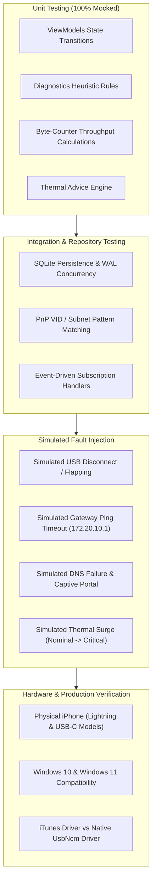

# Testing, Verification & Quality Assurance Plan

This document establishes the testing strategy, simulated fault-injection techniques, performance benchmarks, and automated test suites for both `TetherAssistant` (iOS) and `TetherAssistant.Windows`.

---

## 1. Multi-Tier Testing Strategy

---

## 2. Unit Testing Specifications

### 2.1 iOS Test Suite (Swift Testing / XCTest)
- **`ThermalMonitorTests`**:
  - Validates correct categorization of `ProcessInfo.ThermalState` (.nominal, .fair, .serious, .critical).
  - Verifies that jumping from `.nominal` to `.serious` triggers an urgent warning recommendation.
  - Verifies event stream emission via `AsyncStream`.
- **`BatteryMonitorTests`**:
  - Tests high-risk charging condition: battery level > 80% AND thermal state == `.serious`.
  - Asserts correct formatting of charging states.
- **`SessionRepositoryTests`**:
  - Confirms database insertion, retrieval, and duration calculations.
  - Verifies atomic transaction rollback on disk corruption.

### 2.2 Windows Test Suite (xUnit / MSTest)
- **`NetworkAdapterServiceTests`**:
  - Tests signature matching against mock network interfaces with varying IP addresses, subnets, and operational states.
  - Asserts rejection of non-Ethernet adapters (Wi-Fi, Loopback, VPN TAP/TUN).
  - Asserts rejection of Ethernet adapters with foreign subnets (e.g. `192.168.1.1`).
- **`TelemetryServiceTests`**:
  - Injects sequential byte values (`10,000,000` bytes over `1.0` second) and asserts calculated throughput equals `80.0 Mbps`.
  - Asserts no negative speeds when interface counters overflow/reset.
- **`DiagnosticsServiceTests`**:
  - Injects simulated HTTP/DNS responses to verify all 4 stages.

---

## 3. Simulated Fault Injection & Edge Cases

To ensure production resilience without requiring continuous physical hardware manipulation, mock providers simulate edge cases:

| Test Scenario | Injection Method | Expected Behavior |
| :--- | :--- | :--- |
| **Cable Disconnect While Active** | Trigger NDIS `OperationalStatus.Down` or mock `NetworkAddressChanged`. | Windows app halts telemetry loop cleanly, persists session data to SQLite, transitions UI to "Disconnected", and shows reconnect guidance. |
| **Rapid USB Flapping** | Fire adapter state changes every 100ms for 5 seconds. | Windows app debounces state events; does not crash or spawn runaway background timers. |
| **Personal Hotspot Disabled on iPhone** | Adapter link is up, but gateway `172.20.10.1` drops ICMP packets. | Diagnostics Stage 2 fails with clear guidance: *"iPhone detected, but Personal Hotspot is OFF in iPhone Settings"*. |
| **Cellular Data Depleted / DNS Blackhole** | Gateway ping passes, but DNS lookups to `172.20.10.1` time out after 2000ms. | Diagnostics Stage 3 fails: *"Carrier DNS unreachable. Check mobile data balance or cellular signal"*. |
| **Thermal Escalation on iPhone** | Inject `.serious` or `.critical` thermal state notification. | iOS app emits high-priority audio alert, triggers haptic feedback, and displays bold red cooling card recommending screen dimming and unplugging high-wattage chargers. |

---

## 4. Performance Benchmarks & Quality Gates

All builds must satisfy the following automated performance benchmarks prior to release:

| Category | Benchmark Metric | Hard Threshold |
| :--- | :--- | :--- |
| **Windows CPU Utilization** | Idle (no tethering active) | **< 0.1% CPU** |
| **Windows CPU Utilization** | Active Telemetry (1-second sampling) | **< 1.5% CPU** |
| **Windows Memory Footprint** | Working Set (WinUI 3 process) | **< 65 MB RAM** |
| **iOS CPU Utilization** | Active foreground dashboard | **< 1.0% CPU** |
| **iOS Memory Footprint** | Resident Memory (SwiftUI process) | **< 35 MB RAM** |
| **Diagnostics Latency** | Full 4-stage execution (healthy link) | **< 1.8 seconds** |
| **Database Performance** | Write 1,000 session samples (WAL mode)| **< 45 milliseconds** |

