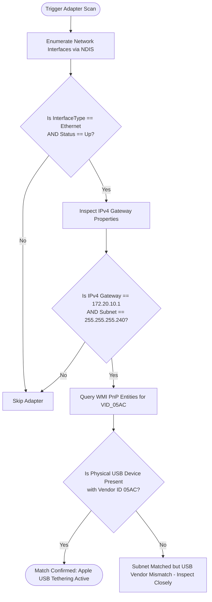

# Windows Companion Implementation Specification

This document provides a technical guide to the Windows companion application (`TetherAssistant.Windows`), detailing the PnP hardware detection, NDIS network integration, real-time telemetry sampling, diagnostic pipeline, and WinUI 3 architecture.

---

## 1. Multi-Tier Hardware & Adapter Detection

To ensure reliability across Windows 10, Windows 11, multi-language operating systems, and various driver versions, detection uses a three-tier identification heuristic.



### 1.1 Detection Implementation (C#)
```csharp
using System;
using System.Linq;
using System.Management;
using System.Net.NetworkInformation;
using TetherAssistant.Windows.Models;

namespace TetherAssistant.Windows.Services;

public class NetworkAdapterDetector
{
    private const string AppleVendorId = "VID_05AC";
    private const string AppleTetheringGateway = "172.20.10.1";
    private const string AppleSubnetMask = "255.255.255.240";

    public AdapterInfo? DetectActiveTetheringAdapter()
    {
        var interfaces = NetworkInterface.GetAllNetworkInterfaces();

        foreach (var nic in interfaces)
        {
            if (nic.OperationalStatus != OperationalStatus.Up)
                continue;

            if (nic.NetworkInterfaceType != NetworkInterfaceType.Ethernet)
                continue;

            var ipProps = nic.GetIPProperties();
            var gateway = ipProps.GatewayAddresses
                .FirstOrDefault(g => g.Address.ToString() == AppleTetheringGateway);

            if (gateway == null)
                continue;

            var unicast = ipProps.UnicastAddresses
                .FirstOrDefault(u => u.IPv4Mask != null && u.IPv4Mask.ToString() == AppleSubnetMask);

            if (unicast == null)
                continue;

            // Found matching gateway & subnet signature. Now correlate with USB PnP VID 05AC.
            bool isAppleUsbPresent = VerifyAppleUsbHardwarePresent();

            return new AdapterInfo
            {
                Id = nic.Id,
                Name = nic.Name,
                Description = nic.Description,
                Status = nic.OperationalStatus,
                IpAddress = unicast.Address,
                SubnetMask = unicast.IPv4Mask,
                GatewayAddress = gateway.Address,
                DnsServer = ipProps.DnsAddresses.FirstOrDefault(),
                SpeedBitsPerSecond = nic.Speed,
                IsAppleTethering = isAppleUsbPresent,
                DetectedAtUtc = DateTime.UtcNow
            };
        }

        return null;
    }

    public bool VerifyAppleUsbHardwarePresent()
    {
        try
        {
            using var searcher = new ManagementObjectSearcher(
                "SELECT DeviceID, Name FROM Win32_PnPEntity WHERE DeviceID LIKE '%VID_05AC%'");
            
            using var collection = searcher.Get();
            return collection.Count > 0;
        }
        catch
        {
            // Fallback for restricted WMI environments: rely on gateway/subnet signature
            return true;
        }
    }
}
```

---

## 2. Event-Driven Adapter Lifecycle Monitoring

Instead of continuous polling loops that waste CPU cycles, the application binds directly to Windows OS network change events:

1. **`NetworkChange.NetworkAddressChanged`**: Fires immediately when an IP address is assigned via DHCP (when tethering starts) or released (when cable is unplugged).
2. **`NetworkChange.NetworkAvailabilityChanged`**: Fires when physical link transitions occur.
3. **WMI Hardware Insertion Watcher (`ManagementEventWatcher`)**: Fires on USB plug/unplug events.

```csharp
public void InitializeEventMonitoring()
{
    NetworkChange.NetworkAddressChanged += OnNetworkChanged;
    NetworkChange.NetworkAvailabilityChanged += OnNetworkChanged;

    try
    {
        var query = new WqlEventQuery(
            "SELECT * FROM __InstanceOperationEvent WITHIN 2 " +
            "WHERE TargetInstance ISA 'Win32_PnPEntity' AND TargetInstance.DeviceID LIKE '%VID_05AC%'");

        _pnpWatcher = new ManagementEventWatcher(query);
        _pnpWatcher.EventArrived += (s, e) => OnNetworkChanged(s, EventArgs.Empty);
        _pnpWatcher.Start();
    }
    catch (Exception ex)
    {
        // Log fallback if WMI event provider is unavailable
    }
}
```

---

## 3. Real-Time Telemetry & Throughput Engine

When an Apple adapter is confirmed active, a lightweight `System.Threading.PeriodicTimer` ticks at 1000ms intervals on a background thread pool thread.

```csharp
public async Task RunTelemetryLoopAsync(NetworkInterface nic, CancellationToken ct)
{
    var timer = new PeriodicTimer(TimeSpan.FromSeconds(1));
    long prevRx = nic.GetIPv4InterfaceStatistics().BytesReceived;
    long prevTx = nic.GetIPv4InterfaceStatistics().BytesSent;
    var prevTime = DateTime.UtcNow;

    while (await timer.WaitForNextTickAsync(ct))
    {
        var now = DateTime.UtcNow;
        var stats = nic.GetIPv4InterfaceStatistics();
        long currentRx = stats.BytesReceived;
        long currentTx = stats.BytesSent;

        double deltaSeconds = (now - prevTime).TotalSeconds;
        if (deltaSeconds <= 0) deltaSeconds = 1.0;

        double rxMbps = ((currentRx - prevRx) * 8.0) / (deltaSeconds * 1_000_000.0);
        double txMbps = ((currentTx - prevTx) * 8.0) / (deltaSeconds * 1_000_000.0);

        prevRx = currentRx;
        prevTx = currentTx;
        prevTime = now;

        var sample = new TelemetrySample
        {
            TimestampUtc = now,
            DownloadSpeedMbps = Math.Max(0.0, rxMbps),
            UploadSpeedMbps = Math.Max(0.0, txMbps),
            TotalBytesReceived = currentRx,
            TotalBytesSent = currentTx,
            SessionDownloadedMB = (currentRx - _sessionInitialRx) / (1024.0 * 1024.0),
            SessionUploadedMB = (currentTx - _sessionInitialTx) / (1024.0 * 1024.0),
            SessionDuration = now - _sessionStartTime
        };

        // Notify subscribers via DispatcherQueue
        TelemetryUpdated?.Invoke(this, sample);
    }
}
```

---

## 4. 4-Stage Diagnostics Engine & Troubleshooting

### Stage 1: Physical Link & NDIS Miniport
- Checks adapter `OperationalStatus == OperationalStatus.Up`.
- Verifies IPv4 configuration assigned via DHCP.
- *Failure Diagnosis*: Apple USB cable is unplugged, dirty Lightning/USB-C port, or "Apple Mobile Device Ethernet" driver is disabled/missing.

### Stage 2: Gateway ICMP Echo Probe (`172.20.10.1`)
- Sends an ICMP echo request (buffer size 32 bytes, timeout 1500 ms) to `172.20.10.1`.
- Measures round-trip time (RTT). Over USB, RTT is typically **0.8 ms – 1.8 ms**.
- *Failure Diagnosis*: iPhone is connected but "Personal Hotspot" is toggled OFF in iPhone Settings, or the iPhone kernel tethering daemon has hung.

### Stage 3: DNS Resolution Probe
- Resolves high-availability domains (`one.one.one.one`, `dns.google`) via the local DNS resolver.
- *Failure Diagnosis*: Gateway ping works, but DNS queries time out. The iPhone cellular data plan is depleted, carrier hotspot entitlement is inactive, or SIM card is searching for signal.

### Stage 4: Internet WAN Connectivity (HTTP 204 Probe)
- Dispatches an HTTP `GET` to `http://cp.cloudflare.com/generate_204` or `http://www.msftconnecttest.com/connecttest.txt` with a 3.0-second timeout.
- Asserts HTTP Status Code `204 No Content` (or `200 OK` with matching body).
- *Failure Diagnosis*: Captive portal detected or carrier firewall blocking external TCP connections.

```csharp
public async Task<DiagnosticStageResult> TestWanConnectivityAsync(CancellationToken ct)
{
    var sw = Stopwatch.StartNew();
    try
    {
        using var client = new HttpClient { Timeout = TimeSpan.FromSeconds(3) };
        using var response = await client.GetAsync("http://cp.cloudflare.com/generate_204", ct);
        sw.Stop();

        if (response.StatusCode == HttpStatusCode.NoContent)
        {
            return new DiagnosticStageResult
            {
                Stage = DiagnosticStage.InternetWanReachability,
                StageName = "WAN Connectivity",
                Severity = DiagnosticSeverity.Pass,
                LatencyMilliseconds = sw.Elapsed.TotalMilliseconds,
                Details = "Direct WAN connection verified via Cloudflare edge.",
                TroubleshootingAdvice = null
            };
        }
        else
        {
            return new DiagnosticStageResult
            {
                Stage = DiagnosticStage.InternetWanReachability,
                StageName = "WAN Connectivity",
                Severity = DiagnosticSeverity.Warning,
                LatencyMilliseconds = sw.Elapsed.TotalMilliseconds,
                Details = $"Unexpected response code: {(int)response.StatusCode}",
                TroubleshootingAdvice = "Check if your carrier requires a captive portal login."
            };
        }
    }
    catch (Exception ex)
    {
        sw.Stop();
        return new DiagnosticStageResult
        {
            Stage = DiagnosticStage.InternetWanReachability,
            StageName = "WAN Connectivity",
            Severity = DiagnosticSeverity.Failure,
            LatencyMilliseconds = sw.Elapsed.TotalMilliseconds,
            Details = ex.Message,
            TroubleshootingAdvice = "Verify cellular data is turned on in iPhone Settings -> Cellular."
        };
    }
}
```

---

## 5. UI/UX Design & WinUI 3 Implementation

### Styling Architecture
- **Mica Backdrop**: Applies native Windows 11 `MicaController` to the main window chrome for fluid desktop integration.
- **Dark Mode First**: High-contrast, dark theme with accent borders (`#3B82F6` electric blue for active tethering, `#10B981` emerald green for healthy state, `#EF4444` crimson red for failures).
- **Smooth Speedometer Gauges**: Rendered via WinUI Canvas and XAML Shapes (`Path`, `ArcSegment`) updating smoothly at 60 FPS.

